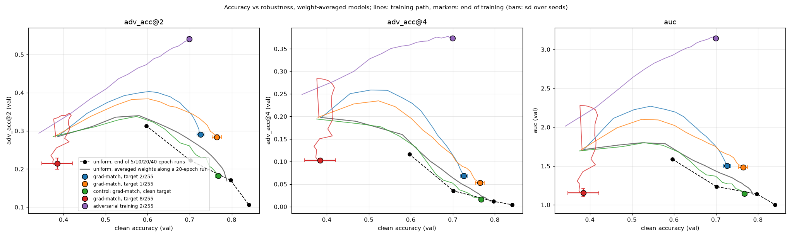

# Ordering training data for adversarial robustness

**Question.** During ordinary training, which updates make a model less
adversarially robust, and can we choose which samples to train on (and when,
including never) so that the model ends up more robust without giving up clean
accuracy?

**Short answer** (details and numbers in [`docs/FINDINGS.md`](docs/FINDINGS.md)):

* Robustness decays during standard training as a slow drift: the direction that
  lowers clean loss and the direction that lowers adversarial loss start out the
  same and separate steadily. No particular samples or updates are to blame, and
  rules that pick samples by a per-sample score (easy, hard, class-balanced,
  first-order "robustness gain") only trade accuracy for robustness along the
  curve that training longer or shorter already traces, or they break training.
* What works is **gradient matching**: at every step, train on the combination
  of *clean* samples whose joint gradient points along the adversarial-training
  direction. At matched clean accuracy it is the only data-only rule we found
  that beats uniform sampling given every weight-space trick (tuned learning
  rate, weight averaging, early stopping, interpolation). CIFAR-10 test split,
  small CNN, strong attack at 2/255, 3 seeds: 0.375 against 0.314 at clean 0.61;
  0.354 against 0.295 at clean 0.65; 0.320 against 0.276 at clean 0.70. Seed
  spread is under one point, the gain holds under AutoAttack, the same sampler
  aimed at the clean gradient gains nothing, and the gain carries over to
  ResNet-20, BatchNorm and CIFAR-100.
* Data ordering alone does not replace adversarial training. Real adversarial
  training at 2/255 reaches 0.53 at clean 0.70 on the same model. No variant
  keeps robustness at 8/255: with a large target radius it is gained early and
  then lost. The sampler costs about 8x a plain training step (adversarial
  training: 2.4x).



**Recommended recipe.** Uniform sampling for one epoch, then gradient matching
with a target radius of 2/255 (1/255 for more clean accuracy), weight averaging
with decay 0.99, and use the *averaged weights before the learning-rate anneal*,
at the epoch that reaches the clean accuracy you need (on the small CNN: epoch 6
for 0.60, 9 for 0.65, 13 for 0.70). Trained checkpoints of the headline models
are in `/gscratch/amath/sgvtc/ordering-ar/models/` (one tar per family, written
by `scripts/archive_models.sh`).

Status, plan and every experiment: [`TODO.md`](TODO.md), [`JOURNAL.md`](JOURNAL.md).

## Using the sampler

Everything that decides which samples are trained on goes through one seam,
`sampler.next_batch(step, model)`, so a rule is independent of model, loss and
dataset.

```bash
# uniform baseline
python -m arorder.train --run-dir RUN --ema-decay 0.99

# gradient matching: uniform for one epoch, then match the 2/255 adversarial direction
python -m arorder.train --run-dir RUN --ema-decay 0.99 \
    --sampler grad_match --pool-mult 4 --select-start-epoch 1 --sampler-args '{"eps": 2}'

# reference: real adversarial training (PGD-3 at 8/255 on every batch)
python -m arorder.train --run-dir RUN --ema-decay 0.99 --train-eps 8

# strong evaluation of a finished run (PGD-50 worst case over restarts and losses, AutoAttack)
python -m arorder.evaluate --run-dir RUN --split test --eps 1 2 4 8 --autoattack
```

Other models and datasets: `--model resnet20`, `--dataset cifar100` (any dataset
stored as one `.npz` in the layout of `arorder.data.prepare_cifar10`). For
models too large to hold per-sample gradients of the candidate pool, pass
`"n_coords": 8192` in `--sampler-args` (fit on a random subset of gradient
coordinates; measured to lose little).

`GradientMatchSampler` options (see its docstring): `eps` (target radius, or a
list tried from the largest down with `min_cos`), `pool_mult` (candidates per
step / batch size), `target` (`"train"` or held-out `"probe"`), `target_n`,
`mix` (blend the clean gradient into the target), `max_repeat` (cap repeats
within a batch), `uniform_frac` (share of each batch drawn uniformly),
`fallback="skip"` (make no update when nothing matches).

## Layout

| Path | What it is |
|---|---|
| `arorder/data.py` | Whole dataset on GPU, fixed train / probe / val split, GPU augmentation. |
| `arorder/models.py` | Small CNN and small ResNets; input normalisation inside the model. |
| `arorder/attacks.py` | Deterministic L-inf PGD (explicit random starts, for paired comparisons). |
| `arorder/robustness.py` | `ProbeEvaluator`: clean and adversarial metrics on fixed held-out points; gradients of held-out adversarial loss, smoothed error and boundary distance. |
| `arorder/train.py` | `Trainer`: step-based training that can be stepped, snapshotted and restored; logs the batch of every update; weight averaging; branching from checkpoints; adversarial training; lookahead order selection. |
| `arorder/samplers.py` | Uniform, class-balanced, pool-filter (score-based) and gradient-matching samplers. |
| `arorder/investigate.py` | One-step replay study from a checkpoint: per-sample first-order effects on held-out robustness plus real finite steps and filter trials. |
| `arorder/evaluate.py` | Strong-attack evaluation of a checkpoint (multi-restart PGD-50, AutoAttack). |
| `scripts/` | Data preparation, sweeps (`sweep.py`), aggregation and plots (`aggregate.py`, `plot_frontier.py`), comparison at matched clean accuracy (`matched_frontier.py`), weight-interpolation reference (`interp_eval.py`), analyses (`analyze_*.py`), final evaluation (`final_eval.py`), checkpoint archive (`archive_models.sh`), Slurm wrappers (`slurm/`), environment (`env.sh`); one-off checks in `adhoc/`. |
| `tests/` | Unit tests of the measurement machinery, samplers and trainer. |
| `results/` | Tables and figures copied out of the (purgeable) run directories. |
| `docs/` | `FINDINGS.md` (what was learned), `KLONE.md` (the cluster), `plans/` (planning agent's brief and plan). |

## Running on klone

Everything that computes runs inside a Slurm job (see `docs/KLONE.md`).

```bash
# one-time: download cifar-10-python.tar.gz into $AR_DATA/raw on a login node, then in a job:
source scripts/env.sh && $PY scripts/prepare_cifar10.py

# tests
srun -A amath -p gpu-rtx6k --gpus=1 -c 4 --mem=16G -t 15 bash -c 'source scripts/env.sh && $PY -m pytest -q tests'

# a sweep: several variants x seeds in one job
sbatch --job-name=sweep scripts/slurm/run.slurm bash -c \
  '$PY scripts/sweep.py --out-root $AR_RUNS/demo --seeds 0 1 2 --common "ema_decay=0.99" \
     --variants uniform "gm2:sampler=grad_match;pool_mult=4;select_start_epoch=1;sampler_args={\"eps\":2}"'
```

## Conventions

* Attack radii are L-infinity, in units of 1/255 on inputs in `[0, 1]`.
* `train` / `probe` / `val` are a fixed split of the official training set
  (45,000 / 2,000 / 3,000). `probe` drives selection signals, `val` is for
  development, and the official test set is used only for final reporting.
* Sample indices in logs are positions within the `train` split.
* A method is judged against the uniform recipe's whole accuracy-robustness
  frontier (tuned hyperparameters, any epoch of the averaged weights, weight
  interpolation) at matched clean accuracy, not against one baseline number
  (`scripts/matched_frontier.py`).
