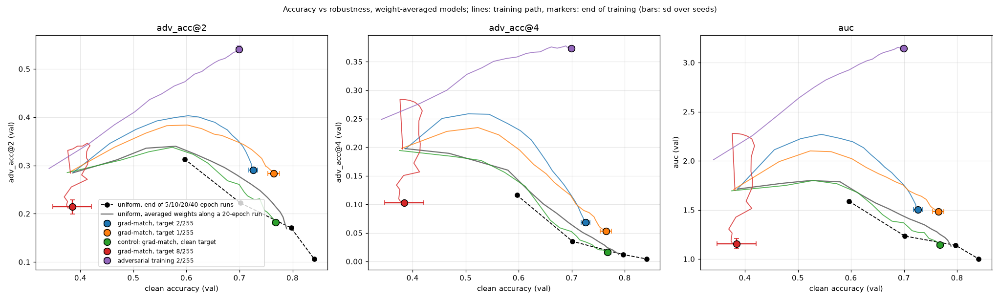

# Findings: what erodes adversarial robustness during training, and what data ordering can do about it

Status: 2026-11-15. Small models (a 0.28 M-parameter CNN with GroupNorm unless
stated) on CIFAR-10; L-infinity attacks, radii in units of 1/255. Validation
numbers use PGD-10 with fixed starts; test numbers use the strong attack (worst
case over 3 restarts x 2 objectives of PGD-50) and AutoAttack where stated.
PGD-10 overstates accuracy at 8/255 by about a third and at 2/255 by a few
points. Run-by-run detail, hardware and job numbers are in `JOURNAL.md`; the
planning agent's independent analysis is in `docs/plans/2026-11-15_phase2_plan.md`.

*Each line is the path of the weight-averaged model through training, each
marker the end of training (bars: sd over seeds). Black dashed: end points of
uniform runs of 5, 10, 20 and 40 epochs.*

## Summary

1. Under ordinary training, robustness at small radii rises for a few epochs and
   then decays for the rest of training while clean accuracy keeps rising. The
   decay is a slow drift of the solution. It is not caused by identifiable bad
   updates or bad samples.
2. The cleanest description of the drift: **the direction that lowers clean loss
   and the direction that lowers adversarial loss are the same at the start of
   training and separate steadily** (cosine 0.98 after epoch 1, 0.29 at the
   end), and training follows the first. In input space, margins grow about 3x
   while the margins' input gradients grow about 8x, for every sample,
   including those that were always classified correctly.
3. Rules that pick samples by a per-sample score (easy, hard, near the boundary,
   class-balanced, first-order effect on held-out robustness) do not help: they
   move the model along the accuracy-robustness curve that training longer or
   shorter already traces, or they break training.
4. **Gradient matching** does help: at every step, train on the combination of
   *clean* samples whose joint gradient points along the adversarial-training
   direction. At matched clean accuracy between 0.60 and 0.75 it is 4-7 points
   of accuracy at 2/255 above the best uniform-sampling recipe we could build
   (learning rate, weight decay, batch size, weight averaging, early stopping
   and weight interpolation all tuned) on validation, and 4-6 points on the test
   split under the strong attack, with a spread over seeds of under one point.
   **The gain exists only for the weight-averaged model taken before the
   learning-rate anneal.** At the end of an annealed 20-epoch schedule gradient
   matching is roughly level with the best uniform recipe (test: 0.728 clean /
   0.261 at 2/255, against 0.705 / 0.276 for uniform with weight interpolation). The same sampler with a clean target
   gains nothing, so the effect is the adversarial direction. It carries over to
   ResNet-20 and to BatchNorm (larger gains) and to CIFAR-100 (smaller gain).
5. Limits.
   * **Clean accuracy is capped.** With a 2/255 target the small CNN never
     reaches 0.75 clean (0.726 at the end of training; 0.764 with a 1/255
     target) where uniform training reaches 0.80 in the same 20 epochs and 0.84
     in 40. ResNet-20: 0.745 against 0.856. The method buys robustness in the
     0.60-0.75 range of clean accuracy and has nothing to offer above it.
   * **It is far from adversarial training.** At clean 0.70, the one level where
     the two can be matched, adversarial training at 2/255 reaches 0.54 at
     2/255; gradient matching 0.34; the best uniform recipe 0.30. Choosing clean
     samples closes under a fifth of that gap (18% on validation, 17% on test).
   * **Nothing holds robustness at 8/255**: with a large target radius it is
     gained early and lost again.
   * **Cost**: about 8x a plain training step, against 2.4x for adversarial
     training.

## 1. The phenomenon

Baseline: uniform shuffling, SGD with momentum, 20 epochs, cosine schedule.

| epoch | clean | 1/255 | 2/255 | 4/255 | boundary distance (linearised, /255) |
|---|---|---|---|---|---|
| 1 | 0.313 | 0.263 | 0.220 | 0.153 | 1.54 |
| 2 | 0.387 | 0.327 | 0.273 | 0.171 | 2.01 |
| 5 | 0.580 | 0.446 | 0.315 | 0.138 | 1.88 |
| 8 | 0.680 | 0.452 | 0.257 | 0.057 | 1.33 |
| 14 | 0.762 | 0.456 | 0.197 | 0.022 | 1.20 |
| 20 | 0.799 | 0.456 | 0.172 | 0.013 | 1.14 |

Robustness peaks at epochs 2-5 depending on the radius, then decays. End points
of uniform runs of different lengths trace the trade-off: 5 epochs 0.597 clean /
0.313 at 2/255; 10 epochs 0.702 / 0.222; 20 epochs 0.797 / 0.171; 40 epochs
0.841 / 0.106 (3 seeds each).

## 2. What the decay is

**A slow drift under large symmetric noise.** With robustness measured before
every one of 7,020 updates: the adversarial-minus-clean loss gap rises by about
4e-4 per update while single updates move it by +-0.04. Half of all updates
raise it and half lower it, in every epoch. No small set of updates carries the
decay.

**Not an artefact of the iterate's oscillation.** An exponential moving average
of the weights is both more accurate and more robust than the raw iterate
mid-training (epoch 6: 0.653 clean / 0.320 at 2/255 against 0.558 / 0.254) and
shows the same rise and decay (peak 0.349 at epoch 4, 0.176 at the end).

**A separation of two directions.** At the averaged weights, with gradients of
the held-out loss (adversarial at 2/255):

| epoch | cos(clean gradient, adversarial gradient) | adversarial / clean gradient norm | samples that lower clean loss but raise adversarial loss |
|---|---|---|---|
| 1 | 0.975 | 1.2 | 1.6% |
| 4 | 0.879 | 1.7 | 4.7% |
| 8 | 0.721 | 2.7 | 6.6% |
| 14 | 0.520 | 4.0 | 5.9% |
| 20 | 0.286 | 4.8 | 12.0% |

**A global loss of input-space margin** (planning agent, from the per-sample
data). Between epochs 2 and 14 the margin of correctly classified training
points grows 2.8x while its input-gradient norm grows 8x. The 6,195 samples that
are correct at every checkpoint lose robustness like the rest (accuracy at 2/255
0.80 to 0.49). Samples that become correct late are non-robust on arrival.

**Class-structured.** 94% of the 2/255 accuracy lost between epochs 4 and 14 is
lost in the seven easier classes while bird, cat and deer are being learned.

**Costliest at the end.** The final learning-rate anneal loses 1.5-3.0 points of
2/255 accuracy per point of clean accuracy gained, against 0.5-1.1 before it.

## 3. Why per-sample attribution does not find culprits

We replayed single updates from saved checkpoints (pure gradient step on a chosen
batch, robustness re-measured with identical attack starts, effect read on
held-out data that played no part in choosing the batch) and computed, for all
45,000 training samples, the first-order effect of training on that sample.

* The measurement itself is sound: noise from the attack is about 100x below the
  spread between batches, first-order predictions match real steps (R^2 0.95-0.99
  at a quarter of the learning rate), and scores from one held-out set predict
  effects on another.
* But a sample's effect on held-out adversarial loss and on held-out clean loss
  are nearly the same ranking early on (Spearman 0.97-0.999), and what a single
  step from a training iterate measures is mostly transient: 20-75% of the
  variance of per-sample effects is the class label, and which classes help
  flips between checkpoints, because the iterate over-predicts different classes
  at different moments.
* The "robustness-only" part of a sample's effect is not predicted by any
  property of the sample (loss, margin, gradient norm, boundary distance, own
  adversarial margin: |Spearman| < 0.25).
* The rule that looked best in one-step replay, selecting by first-order benefit
  to the held-out boundary distance, stalled training when applied at every step
  (0.44 clean after 20 epochs). A bias that is harmless in one step compounds
  over thousands, with momentum on top.

Two measurement pitfalls are worth knowing: a pure step of the full learning
rate from a training iterate is already outside the linear regime, and batches
selected by any inner-product score have gradients 1.4-2.7x longer (or, for easy
samples, 2-8x shorter) than a random batch, so naive comparisons measure step
length.

## 4. Selection rules that only move along the curve (or break training)

All at equal update budget, 3 seeds, 20 epochs unless stated.

| rule | clean | 2/255 | verdict |
|---|---|---|---|
| keep easiest half of each pool (by loss, boundary distance, or own adversarial margin) | 0.52-0.56 | 0.25-0.26 | worse than uniform for 5 epochs (0.597 / 0.313) |
| keep hardest half | 0.815-0.822 | 0.100-0.112 | matched by uniform for 40 epochs (0.841 / 0.106) |
| class-balanced batches | 0.809 | 0.150 | on the uniform curve, slightly further along |
| from epoch 7: drop the hardest quarter | 0.740 | 0.228 | above annealed uniform end points, not above uniform averaged weights mid-run |
| keep best half by held-out "robustness-only" loss gradient | 0.475 | 0.283 | collapsed to chance for an epoch, on the curve after recovery |
| keep best half by held-out adversarial / clean loss gradient | 0.30-0.32 | 0.17-0.20 | training stalls |
| keep best half by boundary-distance gain | 0.436 | 0.231 | training stalls |
| best of 4 data orders per epoch, first 6 epochs (lookahead) | 0.788 | 0.172 | equal to uniform (0.797 / 0.171) |

Weight-space operations do move off the curve (averaged weights mid-run;
interpolating an early averaged model with the final one), so the fair reference
for any sampler is the uniform recipe *with* those operations (section 5).

## 5. Gradient matching

### Idea

Adversarial training updates along `t`, the loss gradient at attacked inputs. A
clean batch's gradient is increasingly unrelated to `t` as training proceeds
(section 2). But the clean per-sample gradients `g_i` of a few hundred candidate
samples span a cone that contains a good approximation of `t`. So at each step:
draw candidates, measure `t` on *other* samples, solve
`min_{w >= 0} || sum_i w_i g_i - t ||`, and train on a batch in which sample `i`
appears in proportion to `w_i`. Every update is an ordinary step on clean
training samples; only the choice of samples used the attack.

Implemented as `arorder.samplers.GradientMatchSampler` (`sampler="grad_match"`).
Default configuration in everything below: uniform sampling for the first
epoch, then 512 candidates and 256 target samples per step, batch 128, target
radius 2/255, weight averaging with decay 0.99.

### Why it can work: the fit

Cosine with the adversarial gradient at 8/255 (held-out half of the target), 512
candidates: uniform pool mean 0.37 / 0.24 / 0.10 at epochs 4 / 11 / 17 of a
standard run; fitted combination 0.89 / 0.70 / 0.55. On an adversarially trained
model the fit stays at 0.86-0.89 to the end. About a quarter of the candidates
carry the weight. A random 3% of the gradient coordinates is enough for the fit;
the last layer alone is not.

### Result at matched clean accuracy (validation, averaged weights)

Best accuracy at 2/255 among operating points (variant x epoch, mean over seeds)
whose clean accuracy is at least the level:

| clean at least | uniform, default and lr 0.025 (5 seeds) | uniform, all tuning + weight interpolation (3 seeds) | **gradient matching 2/255 (5 seeds)** | gradient matching 1/255 (3 seeds) | clean-target control (2 seeds) | adversarial training 2/255 (3 seeds) |
|---|---|---|---|---|---|---|
| 0.55 | 0.342 | 0.342 | **0.403** | 0.384 | 0.338 | 0.541 |
| 0.60 | 0.331 | 0.340 | **0.403** | 0.384 | 0.323 | 0.541 |
| 0.65 | 0.306 | 0.317 | **0.389** | 0.365 | 0.286 | 0.541 |
| 0.70 | 0.276 | 0.297 | **0.340** | 0.343 | 0.245 | 0.540 |
| 0.75 | 0.234 | 0.245 | not reached | **0.297** | 0.203 | not reached |

"All tuning" = learning rate x0.5 and x2, weight decay 0 and 2e-3, batch 64, any
epoch of the averaged weights, and interpolation of an early averaged model
(epoch 3-6) with the final one for the default and the lr 0.025 runs, the two
best uniform variants. Seed sd at the selected points: gradient matching 0.005-0.009,
uniform 0.009-0.028. The same holds at 4/255 (0.229 against 0.141 at clean
>= 0.60) and for the area under the robust-accuracy curve.

### Confirmation on the test split (strong attack, averaged weights, 3 seeds)

Operating points were chosen on validation (from the 3-seed tables, before
seeds 3 and 4 existed) and evaluated once on test, seeds 0-2. Rows are grouped
by clean accuracy.

| model | clean | 1/255 | 2/255 | 4/255 |
|---|---|---|---|---|
| gradient matching, epoch 6 | 0.609 +- 0.009 | 0.489 | **0.375 +- 0.007** | 0.195 |
| uniform lr 0.025, epoch 5 | 0.610 +- 0.008 | 0.457 | 0.314 +- 0.007 | 0.123 |
| gradient matching, epoch 9 | 0.656 +- 0.007 | 0.501 | **0.354 +- 0.006** | 0.138 |
| uniform, epoch-4 average interpolated half-way to the final weights | 0.653 +- 0.004 | 0.463 | 0.295 +- 0.019 | 0.092 |
| uniform, epoch 6 | 0.653 +- 0.006 | 0.455 | 0.280 +- 0.028 | 0.076 |
| gradient matching, epoch 13 | 0.703 +- 0.009 | 0.501 | **0.320 +- 0.002** | 0.094 |
| uniform, epoch-3 average interpolated three quarters of the way to the final weights (5 seeds) | 0.705 +- 0.008 | 0.481 | 0.276 +- 0.015 | 0.060 |
| uniform lr 0.025, epoch 10 | 0.710 +- 0.004 | 0.461 | 0.242 +- 0.018 | 0.039 |

Gain over the best uniform row at the same clean accuracy: +0.061 at 0.61,
+0.059 at 0.65, +0.044 at 0.70.

End of the annealed 20-epoch schedule, same attack, 3 seeds: uniform 0.795 /
0.146 at 2/255; uniform 10 epochs 0.707 / 0.201; uniform 5 epochs 0.600 / 0.287;
gradient matching 2/255 0.728 / 0.261; gradient matching 8/255 0.393 / 0.188
(0.007 at 8/255); adversarial training 8/255 0.519 / 0.449 (0.269 at 8/255).

**AutoAttack** (standard version, first 2,000 test points, seed 0), next to the
strong PGD attack on the same points:

| model | clean | 2/255: PGD-50 worst case | 2/255: AutoAttack | 4/255: PGD-50 worst case | 4/255: AutoAttack |
|---|---|---|---|---|---|
| gradient matching, epoch 9, averaged | 0.656 | 0.365 | **0.359** | 0.158 | 0.138 |
| uniform, epoch 6, averaged | 0.657 | 0.319 | 0.310 | 0.110 | 0.097 |
| gradient matching, end | 0.735 | 0.267 | 0.255 | 0.049 | 0.038 |
| uniform 20 epochs, end | 0.805 | 0.166 | 0.149 | 0.006 | 0.005 |
| adversarial training 2/255, end | 0.702 | 0.529 | 0.525 | 0.356 | 0.343 |

AutoAttack lowers every model by 0.4-2 points. For the matched pair the drop is
0.6 (gradient matching) against 0.9 (uniform) at 2/255 and 2.0 against 1.3 at
4/255; the ordering and the size of the gap are unchanged, so the gain is not
gradient masking. (Seed 0 is the uniform
recipe's best seed at epoch 6; its 3-seed mean at 2/255 is 0.280.)

### End of training (20 epochs, annealed), validation

| run | seeds | clean | 2/255 | 4/255 | 8/255 |
|---|---|---|---|---|---|
| uniform | 3 | 0.797 +- 0.007 | 0.171 +- 0.013 | 0.012 | 0.000 |
| gradient matching 2/255 | 5 | 0.726 +- 0.009 | 0.290 +- 0.004 | 0.068 | 0.001 |
| gradient matching 1/255 | 3 | 0.764 +- 0.013 | 0.284 +- 0.006 | 0.053 | 0.001 |
| gradient matching 4/255 | 1 | 0.581 | 0.257 | 0.075 | 0.004 |
| gradient matching 8/255 | 3 | 0.384 +- 0.037 | 0.214 +- 0.015 | 0.102 | 0.022 |
| adversarial training 2/255 | 3 | 0.699 +- 0.005 | 0.541 +- 0.007 | 0.37 | 0.12 |
| adversarial training 8/255 | 3 | 0.510 +- 0.004 | 0.458 +- 0.005 | 0.400 | 0.295 |

Stopping before the anneal and using the averaged weights gives the better
models (tables above). The anneal costs gradient matching more robustness than
it costs uniform training: its end point (0.726 / 0.290 on validation) sits on
the uniform recipe's frontier with interpolation (0.297 at clean >= 0.70, 0.245
at >= 0.75) and above it only without interpolation. Note also the first
column: gradient matching ends 3-7 points of clean accuracy below uniform.

### Other architecture, other dataset (validation, averaged weights, 2 seeds; uniform varied by epochs only)

| setting | clean at least | uniform | gradient matching 2/255 |
|---|---|---|---|
| ResNet-20 (GroupNorm), CIFAR-10 | 0.60 | 0.263 | 0.384 |
| | 0.70 | 0.178 | 0.374 |
| | 0.75 | 0.169 | 0.335 |
| SmallCNN, CIFAR-100 | 0.30 | 0.145 | 0.170 |
| | 0.35 | 0.136 | 0.161 |

| SmallCNN with BatchNorm, CIFAR-10 | 0.60 | 0.348 | 0.417 |
| | 0.70 | 0.297 | 0.362 |
| | 0.75 | 0.246 | 0.353 |
| | 0.80 | 0.224 | 0.231 |

End of training: ResNet-20 uniform 0.856 / 0.080 at 2/255, gradient matching
0.745 / 0.301; CIFAR-100 uniform 0.422 / 0.091, gradient matching 0.369 /
0.153; BatchNorm uniform 0.858 / 0.088, gradient matching 0.803 / 0.134. With
BatchNorm the model learns faster and the advantage is gone by clean 0.80.

Fitting on a random 8,192 of the 280,000 gradient coordinates (the route to
models whose per-sample gradients do not fit in memory) works in closed loop:
0.729 clean / 0.276 at 2/255 at the end of training against 0.726 / 0.290 for
the full fit (1 seed).

### Why large radii collapse

The unconstrained fit concentrates: in the 8/255 run a batch of 128 holds 60
effective distinct samples in epoch 2 and 18 in epoch 20, and by then 10% of the
training set receives 99% of the updates. The rest of the data stops being
trained on, the clean gradient of a random batch ends up pointing *against* the
adversarial gradient (cosine -0.45), and the match falls from 0.93 to 0.31.
Tried against it without success: a larger or smaller pool, mixing the clean
gradient into the target, a held-out target, matching from step 0, capping
repeats within a batch (weakens the match, and with it the effect). Reserving
half of every batch for uniform samples prevents the collapse (0.749-0.761
clean) but the robustness at 8/255 is not kept. With targets of 1-2/255 the same
drift is slow enough that runs end well.

### Cost

About 8x a plain step on the small CNN (per-sample gradients of 512 candidates,
an attack on 256 target samples, a 512-variable least-squares fit) against 2.4x
for PGD-3 adversarial training; 81 minutes for 20 epochs of ResNet-20. It is a
way of getting robustness out of the *choice* of clean samples, not a cheaper
adversarial training.

## 6. Adversarial training as the reference, and ordering under it

Training on attacked inputs is far ahead of anything a choice of clean samples
achieves (tables above; at clean 0.70, 0.54 at 2/255 against 0.34). A small model underfits adversarial training:
robustness rises throughout and there is no decay to protect against. There,
rules that speed learning up help both accuracy and robustness: class-balanced
batches 0.539 clean / 0.483 at 2/255, and keeping the 75% of each pool with the
lowest adversarial margin 0.547 / 0.482, against uniform 0.510 / 0.458 (training
radius 8/255, 20 epochs, 3 seeds; uniform for 40 epochs: 0.566 / 0.510).
Easy-sample rules hurt.

## 7. What is not established

* Five seeds for the headline pair, two or three elsewhere.
* The uniform references for ResNet-20 and CIFAR-100 vary epochs only (no
  learning-rate or interpolation tuning there).
* BatchNorm: per-sample gradients are taken in eval mode while training uses
  batch statistics. The gain survives on the small CNN (2 seeds); no deeper
  BatchNorm network was run.
* AutoAttack was run on one seed and 2,000 test points per model.
* Test confirmation uses seeds 0-2 at operating points chosen on the 3-seed
  validation table; the 5-seed validation table picks neighbouring epochs for
  some levels.
* Runs started before 14:55 on 2026-11-15 do not record the code revision, and
  the sampler was being extended while some were queued (`JOURNAL.md`).
* Whether the late collapse at large radii can be removed, and with it whether
  data ordering can reach robustness at 8/255 at all.
* Larger models, longer schedules, and adversarial training with robust
  overfitting, where "which updates destroy robustness" has a second meaning.
